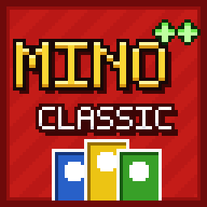

<div align="center">
  

  <h1>Mino++: Classic</h1>
  <h2><em>A card table for Minecraft 1.7.10</em></h2>

  <p>
    <strong>Shed your hand, shout "Mino!", and watch out for the Draw Ten.</strong>
  </p>

  <p>
    <a href="https://github.com/GTNotLeisure/Minopp-Classic/releases/latest">
      
    </a>
    <a href="https://www.gnu.org/licenses/gpl-3.0.html">
      
    </a>
    
  </p>

  <p>
    <b>Mino++: Classic</b> brings a well-known color-and-number card game to Minecraft 1.7.10.
    <br>
    Place a table, sit down with friends or bots, mix <strong>27 card packs</strong>, tune <strong>32 rules</strong>
    and play with an animated, controller-style interface.
  </p>
</div>

<hr>

## 📑 Table of Contents
- [📑 Table of Contents](#-table-of-contents)
- [🔧 Required Dependencies](#-required-dependencies)
- [✨ Key Features](#-key-features)
- [🃏 Card Packs](#-card-packs)
- [📏 Rules](#-rules)
- [🎮 Controls](#-controls)
- [🧩 For Addon Developers](#-for-addon-developers)
- [🖥️ Server Configuration](#️-server-configuration)
- [📥 Downloads \& Compatibility](#-downloads--compatibility)
- [🧱 Building](#-building)
- [📜 Credits \& Attributions](#-credits--attributions)

<hr>

## 🔧 Required Dependencies

* [GTNHLib (>= 0.11.54)](https://github.com/GTNewHorizons/GTNHLib)

Optional:

* [NeverEnoughCharacters](https://github.com/asdflj/NeverEnoughCharacters-Rework): the settings search box then accepts pinyin for Chinese names.

## ✨ Key Features

* **A real table**: a 3×3 table you place in front of you. Seats go around it, the draw pile and discard pile sit in the middle, and every hand is visible from the outside.
* **Hand at your fingertips**: your hand fans out at the bottom of the screen. Playable cards glow on your turn. Right click to grab the cards, A/D to pick one, Space to play it.
* **3D color picker**: picking a wild color raises four pillars from the table. Point at one, or use WASD and Enter.
* **Mix any packs**: combine the Classic deck with No Mercy, Flip, Flex, All Wild, Party and twenty more packs, including the official Add-On Packs. A card that appears in several packs is counted once.
* **Official rules**: challenge a Wild Draw Four, use the official opening card, score points to a target (single round, 200, 300, 500, 750, 1000 or your own number), and see a settlement board after every round.
* **House rules**: Jump-In, Stacking, 7-0, Draw to Match, Play Doubles, Bring a Card, Deflect, Mercy Rule, and more.
* **Team mode**: up to 10 equally sized teams, optional team relay.
* **Bots**: seat bots from the table lobby (left click adds, right click removes). Bots stay at their table, and a stand-in plays for anyone who disconnects mid-game.
* **Saved designs**: keep your favorite pack and rule setups and apply them to any table.
* **Animations**: direction arrows on the table, bouncing skip signs, a coin toss for 50/50, the Time Balloon swelling over its holder, flying cards, and particles for expansion cards.
* **Translations**: English, 简体中文, 繁體中文（台灣）, 繁體中文（香港）, Deutsch and 日本語.

<hr>

## 🃏 Card Packs

The **Classic** deck provides the number cards. Packs without numbers always get the Classic deck added when you pick them as a preset.

| Pack | Players | Contents |
|:-----|:-------:|:---------|
| **Classic** | 2–10 | The original 108 card deck. |
| **No Mercy** | 2–6 | 168 brutal cards: Discard All, Skip Everyone, Wild Draw Six and Ten, Wild Color Roulette; mercy rule and stack-any. |
| **Flip** | 2–10 | Double-sided deck: Redstone, Gold, Emerald and Diamond on the light side; Rose Quartz, Turquoise, Amber and Amethyst on the dark side. |
| **Flex** | 2–6 | Two-colored Flex cards and power cards. |
| **All Wild** | 2–10 | Every card is wild: just play the action. |
| **Party** | 6–16 | Point Taken, Drawn Together, Pile Up. |
| **Modern Classic** | 2–10 | Gift, Bonus Turn, Wild Swap Hands, Wild Hand Shuffle. |
| **Legend Pack** | 2–8 | Trial: everyone discards a color or draws. |
| **Anniversary Pack** | 2–8 | 50/50: a coin flip decides who draws 4. |
| **Weekend Pack** | 2–8 | Wild Draw Six, Wild Reverse Draw Six, Double Discard All, Time Balloon. |
| **Blaster Pack** | 2–8 | Blaster, Wild Blast All, Trade Hands, Discard All. |
| **Jungle Pack** | 2–8 | Wild Hand Shuffle, Wild Rebound, Wild Smoke Bomb, Wild Echo. |
| **Dance Pack** | 3–10 | Wild Crossfade, Wild Dance Floor, Wild Even Out, Wild Surprise. |
| **Rascal Pack** | 2–8 | Wild Card Storm, Wild Booby Trap, Wild Hurry Up, Wild Shield. |
| **Myth Pack** | 2–8 | Wild Trickster, Wild Surge. |
| **Whirlwind Pack** | 3–8 | Wild Cyclone, Wild Thief. |
| **Teams Pack** | 4–20 | Wild Team Play, Wild Team Draw Four, team relay. |
| **Stack Pack** | 2–10 | Stack 1, Stack 2, Wild Stack 3, Wild Stack Number: answer a draw of the same color and pass it on. |
| **Swap Pack** | 3–10 | Swap 1, Refresh Hand, Wild Force Trade, Wild Pass Hands. |
| **Reverse Pack** | 3–10 | Reverse Skip, Reverse Draw Two, Wild Power Reverse, Wild NO U. |
| **Speed Pack** | 2–8 | Speed Up and Wild Double Speed Up: play that many cards per turn or crash and draw. |
| **Frenemies Pack** | 3–10 | Wild Petty Play, Wild Eliminator, Wild Instigator, Wild Nemesis. |
| **Defense Pack** | 2–10 | Wild Block, Wild Block and Rebound, Wild Block and Deflect, Wild Redirect. |
| **Comeback Pack** | 2–10 | Wild Swap Hands, Wild Match the Max, Wild Misery Loves Company. |
| **Love Island Pack** | 3–10 | Wild Eggs in One Basket, Wild Pull You for a Chat, Wild I've Got a Text. |
| **Billie Eilish Pack** | 2–10 | Wild Pass Color, Trick Wild, Wild Color Challenge, Reveal Hands. |
| **Show 'Em No Mercy Expansion** | 2–6 | 10 Play Again, Wild Discard All, Wild Reverse Draw 8, Wild Final Attack, Wild Sudden Death, plus the Mercy / No Mercy coins. Adds the No Mercy deck. |

<details>
<summary><strong>How mixed packs build the deck (Click to expand)</strong></summary>
<br>

* Every card face is counted once. If two enabled packs contain the same card, the deck gets the larger of their counts.
* A count you set yourself in the Cards tab always wins.
* Heavy draw cards (Draw Six, Draw Ten, Color Roulette) switch on the Mercy rule when you add them, so a game cannot grow forever.
* Flex cards switch on Flex Power. Rules that depend on another rule switch it on with them (Stack Any Draw needs Stacking, Team Relay needs Team Mode).
</details>

<hr>

## 📏 Rules

<details>
<summary><strong>📘 Basic (Click to expand)</strong></summary>
<br>

* **Play Drawn Card**: a card you just drew may be played right away.
* **Official Opening Card**: the first card is turned over and applied like in the official rules.
</details>

<details>
<summary><strong>🏠 House Rules (Click to expand)</strong></summary>
<br>

* **Jump-In**: play an identical card out of turn.
* **Stacking**: answer a draw card with another one and pass the total on.
* **7-0**: a 7 swaps hands with a player you choose, a 0 rotates all hands.
* **Draw to Match**: keep drawing until you can play.
* **Forced Play**: you must play when you can.
* **No Bluffing** / **Challenge Wild Draw Four**: control whether a Wild Draw Four can be challenged.
* **Stack Draw Four on Draw Two**, **Deflect**.
* **Play Doubles**: after a number card, add more cards with the same number.
* **Bring a Card** (off by default): after a colored action card, play one more card of the same color.
* **Number Finish**: your last card must be a number card.
</details>

<details>
<summary><strong>💀 No Mercy (Click to expand)</strong></summary>
<br>

* **Mercy Rule**: a player who reaches the limit (default 25 cards) is out.
* **Stack Any Draw**: any draw card can answer any other.
</details>

<details>
<summary><strong>🎲 Modes and Table (Click to expand)</strong></summary>
<br>

* **Team Mode** with 2 to 10 teams, **Team Relay**, **Flip Mode**, **Flex Power**.
* **Coins**: every player gets a coin and picks a side before their first move. Mercy swaps the whole hand for 7 fresh cards (and saves you from being knocked out); No Mercy doubles your next draw card. Once per game; works with any deck.
* **See Everyone's Hand** (off) and **Flip: See Card Backs** (on).
* **Seats** (2–20), **Starting Hand**, **Deck Copies** (automatic for big tables), **Jump-In Window**, **Mino Penalty**, **Balloon Penalty**.
* **Points Target**: single round, 200, 300, 500, 750, 1000, or a custom value. The winner of a round scores the cards left in the other hands (numbers at face value, actions 20, wilds 50).
</details>

<hr>

## 🎮 Controls

<details>
<summary><strong>🃏 At the table (Click to expand)</strong></summary>
<br>

* Hold the hand cards and **right click** to enter interaction mode. Right click again (or Esc) to move freely.
* **A / D**, arrow keys or the mouse wheel pick a card. **Space** or left click plays it. **Q** draws or passes.
* Shout **Mino!** with the button, by holding Ctrl while playing, or by typing "Mino" in chat. You can only shout on your own turn with two cards or fewer.
* Hit a player who forgot to shout to catch them.
* With `classicInteraction=true` the hand is shown on the right and W/S pick a card.
</details>

<details>
<summary><strong>⚙️ Settings screen (Click to expand)</strong></summary>
<br>

* **Q / E** (or click the keys) switch tabs. **W A S D** or the arrow keys move between tiles like a TV remote, **Enter** / **Space** acts as a left click and **R** as a right click.
* Number tiles: left click −1, right click +1, Shift+left click clears, Shift+right click lets you type a value (Enter or click elsewhere confirms), Ctrl+click restores the default.
* Type in the search box at the bottom left (or press `/` or Ctrl+F) to filter every tab.
</details>

<hr>

## 🧩 For Addon Developers

Card types register through `CardTypes.register(CardType.builder(...)...build())`. Table animations for a card register on the client through `CardFxRegistry`:

```java
CardFxRegistry.register("my_wild_bomb", ctx -> {
    ctx.bigText("BOOM", 0xFF4020, ctx.pile().add(0, 1.6, 0), 300, 1400);
    ctx.burst(ctx.pile(), 0xFF4020, 200);
});
```

The context can start every built-in animation (skip signs, reverse arrows, the color pillar, flying draw cards, big text, coin, particles) or a custom renderer, and `cancelDefaults()` replaces the generic animation for the card's kind. The mod's own card animations are registered the same way.

<hr>

## 🖥️ Server Configuration

`config/minopp/minopp-server.cfg` (also editable from the mod list):

| Option | Default | Effect |
|:-------|:-------:|:-------|
| `allowPeeking` | `true` | Lets rooms turn on their "See Everyone's Hand" rule (off by default per room). When false, no room can, and other players' cards are never sent to clients. |
| `everyoneCanManageBots` | `false` | Let every player add and remove bots. When off, only the room host and operators can. |

**Room permissions:** the player who places a table hosts its room; while they are offline the first online player seated there takes over. Only the host and operators (or the single-player world owner) can start or stop games, change rules, packs and card counts, reset seats, set bots' teams and break the table. Anyone can take or leave a seat and pick their own team.

<hr>

## 📥 Downloads & Compatibility

| Minecraft | Forge | Status | Download |
|:---------:|:-----:|:------:|:---------|
| **1.7.10** | `10.13.4.1614` | ✅ **Supported** | [](https://github.com/GTNotLeisure/Minopp-Classic/releases/latest) |

Works with GT New Horizons and with [Angelica](https://github.com/GTNewHorizons/Angelica).

## 🧱 Building

* **Java**: a modern JDK (the build downgrades bytecode for Java 8 with JvmDowngrader)
* **Gradle wrapper**: use the included `gradlew` / `gradlew.bat`
* Build: `./gradlew build` (Windows: `gradlew.bat build`)
* Run the tests: `./gradlew test`

Install the plain `minopp-*.jar` together with GTNHLib. The `-dev`, `-sources` and `-predowngrade` jars are for development.

<hr>

## 📜 Credits & Attributions

| Project | Author | License |
|:--------|:-------|:--------|
| **Mino++** (original mod) | [Zbx1425](https://github.com/zbx1425/minopp) | [MIT](./LICENSE-MIT-Zbx1425.txt) |
| **Mino++: Expanded** | [VengeancePC](https://github.com/VengeancePC/Minopp-Expanded) | [MIT](./LICENSE-MIT-Zbx1425.txt) |
| **GTNHLib** | [GTNewHorizons](https://github.com/GTNewHorizons/GTNHLib) | [LGPLv3](https://www.gnu.org/licenses/lgpl-3.0.html) |

Mino++: Classic is a 1.7.10 port and continuation of Mino++: Expanded. Code taken from Mino++ remains available under its original MIT license; see [LICENSE-MIT-Zbx1425.txt](./LICENSE-MIT-Zbx1425.txt).
This project is not affiliated with or endorsed by Mattel or Ubisoft.

---

<p align="center">Licensed under <strong>GPLv3</strong>.</p>
